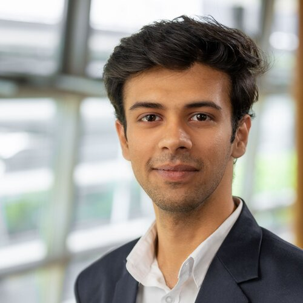

<!-- GitHub profile README: lives in the repo "ajadav-mech/ajadav-mech" -->

# Agney Jadav

**Mechatronics Engineer · Additive Manufacturing · Automation · CAD · Materials R&D**

Master's student in Engineering Sciences – Mechatronics @ TH Rosenheim, Germany

Metal 3D-printing research, PLC digital twins, DfAM parts, robots, and a 3D-printing business that sold real products.

[🌐 Portfolio](https://ajadav-mech.github.io) · [💼 LinkedIn](https://www.linkedin.com/in/agneyjadav/) · [✉️ agney2001@gmail.com](mailto:agney2001@gmail.com) · 📞 +49 1551 0677866

**🟢 Open to Werkstudent roles now · Full-time graduate roles from 2027 · Anywhere in Germany**

[English](#-english) · [Deutsch](#-deutsch)

---

## 🇬🇧 English

### What I do

| Area | Evidence |
|---|---|
| **Additive Manufacturing** | Master's thesis on LPBF 316L with rare-earth oxides (TruPrint 1000) · AM vacuum gripper at 51.7 g · co-founded a 3D-printing business (FDM/DLP) |
| **PLC & Automation** | Digital twin and control UI for a 5-station Siemens PLC lab (ArchestrA, S7) · STM32 robot control |
| **CAD & Mechanical Design** | CSWA (Mechanical Design & Additive Manufacturing) · 20+ products designed and sold · robot mechanisms and linkages |
| **R&D & Materials** | Ball milling, SEM/EDX, metallography, hardness testing with Welch ANOVA, FEM/CFD in ANSYS |

### Featured projects

| Project | What it shows |
|---|---|
| [**LPBF 316L + rare-earth oxide inoculants**](https://github.com/ajadav-mech/lpbf-316l-inoculation) | Master's thesis: milling route development, LPBF printing, SEM/EDX, statistical hardness analysis |
| [**AM pneumatic vacuum gripper**](https://github.com/ajadav-mech/pneumatic-vacuum-gripper-dfam) | DfAM: 4 integrated Venturi nozzles, 51.7 g vs. 100 g limit, 2× required suction, FEM + topology optimisation |
| [**Digital twin of a PLC production lab**](https://github.com/ajadav-mech/digital-twin-production-facility) | ArchestrA HMI linked to Siemens PLCs over S7, SolidWorks-based animated stations, live sensor data |
| [**Self-balancing robot with leg mechanism**](https://github.com/ajadav-mech/self-balancing-robot) | 3rd prize ROBOFEST-Gujarat 3.0 · STM32, steppers, 4-bar linkage knees |
| [**Sewing3D – 3D-printing business**](https://github.com/ajadav-mech/sewing3d) | 20+ 3D-printed aircraft models designed, produced and sold on Amazon India |
| [**Hydraulic manifold for LPBF**](https://github.com/ajadav-mech/hydraulic-manifold-lpbf) | Manifold redesigned for metal additive manufacturing |
| [**ARISTO XT robotic arm**](https://github.com/ajadav-mech/aristo-xt-robotic-arm) | Bachelor's thesis: robotic arm design and build |
| [**Walking robots**](https://github.com/ajadav-mech/walking-robots) | Biped, quadruped and hexapod robots, plus competition results |
| [**Industrial IoT projects**](https://github.com/ajadav-mech/iiot-projects) | 3D printer with robotic part removal, smart home security with face recognition, smart charger |

### Experience

- **Co-Founder & Prototype Developer – Sewing3D, India** (Jun 2023 – May 2025): CAD, FDM/DLP prototyping and production, workflow optimisation, machine reliability
- **Robotics Instructor – BrightCHAMPS** (Jun 2023 – Dec 2024): taught embedded systems, sensors and automation basics to 50+ students in India, Japan and the USA
- **Production Technology Intern – RAJOO Engineers, India** (Jun 2022 – Jul 2023): plastics extrusion machinery; CNC machining (5-axis, VMC) and G-code, PLC programming and sensor integration, production and process optimisation

### Education

- **Master's in Engineering Sciences – Mechatronics**, TH Rosenheim, Germany (Oct 2024 – present)
- **Bachelor's in Mechatronics Engineering**, U. V. Patel College of Engineering, Ganpat University, India (2019 – 2023), grade 1.46

### Tools

**Manufacturing:** LPBF · PolyJet · FDM · DLP · CNC (5-axis, VMC) · G-code · plastic processing
**Analysis:** FEM/CFD · SEM/EDX · metallography · hardness testing · statistics (ANOVA) · SAS

### Certifications & awards

- 🏅 CSWA – Mechanical Design and CSWA – Additive Manufacturing (Dassault Systèmes, 2023)
- 🥉 3rd prize, prototype stage, ROBOFEST-Gujarat 3.0 (GUJCOST, Dec 2023): self-balancing robot, ₹5,00,000 team prize
- 🥈 2nd place in Robo Soccer (Convergence'22), Robo War (PRAXES 2K23) and Motoboat (Plinth 2023)

**Languages:** English C1 (IELTS 8.0) · German B1, B2 exam Nov 2026 · Hindi & Gujarati native

---

## 🇩🇪 Deutsch

### Schwerpunkte

| Bereich | Nachweis |
|---|---|
| **Additive Fertigung** | Masterarbeit zu LPBF 316L mit Seltenerdoxiden (TruPrint 1000) · additiv gefertigter Vakuumgreifer mit 51,7 g · Mitgründer eines 3D-Druck-Unternehmens |
| **SPS & Automatisierung** | Digitaler Zwilling und Bedienoberfläche für ein Siemens-SPS-Labor mit 5 Stationen (ArchestrA, S7) · STM32-Robotersteuerung |
| **CAD & Konstruktion** | CSWA (Mechanical Design & Additive Manufacturing) · 20+ Produkte konstruiert und verkauft · Robotermechanismen |
| **F&E & Werkstoffe** | Kugelmahlen, REM/EDX, Metallographie, Härteprüfung mit Welch-ANOVA, FEM/CFD in ANSYS |

### Projekte

| Projekt | Inhalt |
|---|---|
| [**LPBF 316L + Seltenerdoxide**](https://github.com/ajadav-mech/lpbf-316l-inoculation) | Masterarbeit: Mahlprozess, LPBF-Druck, REM/EDX, statistische Härteanalyse |
| [**Additiv gefertigter Vakuumgreifer**](https://github.com/ajadav-mech/pneumatic-vacuum-gripper-dfam) | 4 integrierte Venturi-Düsen, 51,7 g statt 100 g, doppelte Saugleistung |
| [**Digitaler Zwilling eines SPS-Labors**](https://github.com/ajadav-mech/digital-twin-production-facility) | ArchestrA-HMI mit Siemens-SPS über S7 |
| [**Selbstbalancierender Roboter**](https://github.com/ajadav-mech/self-balancing-robot) | 3. Preis ROBOFEST-Gujarat 3.0 |
| [**Sewing3D**](https://github.com/ajadav-mech/sewing3d) | 20+ Flugzeugmodelle über Amazon India verkauft |
| [**Hydraulikblock für LPBF**](https://github.com/ajadav-mech/hydraulic-manifold-lpbf) | LPBF-gerechte Neukonstruktion |
| [**ARISTO XT Roboterarm**](https://github.com/ajadav-mech/aristo-xt-robotic-arm) | Bachelorarbeit |
| [**Laufroboter**](https://github.com/ajadav-mech/walking-robots) | Zweibeiner, Vierbeiner, Hexapod |
| [**IIoT-Projekte**](https://github.com/ajadav-mech/iiot-projects) | 3D-Drucker mit Roboterarm, Smart-Home-Sicherheit, Smart Charger |

### Berufserfahrung

- **Mitgründer & Prototypenentwickler – Sewing3D** (06/2023 – 05/2025)
- **Robotik-Dozent – BrightCHAMPS** (06/2023 – 12/2024): 50+ Schüler in Indien, Japan und den USA
- **Praktikant Produktionstechnik – RAJOO Engineers** (06/2022 – 07/2023): CNC (5-Achs, VMC), SPS und Sensorintegration, Prozessoptimierung

### Ausbildung

- **Master Ingenieurwissenschaften – Mechatronik**, TH Rosenheim (seit 10/2024)
- **Bachelor Mechatronik**, U. V. Patel College of Engineering, Ganpat University (2019 – 2023), Note 1,46

**Sprachen:** Englisch C1 (IELTS 8,0) · Deutsch B1, B2-Prüfung 11/2026 · Hindi & Gujarati Muttersprache

**🟢 Werkstudent ab sofort · Festanstellung ab 2027 · deutschlandweit**
